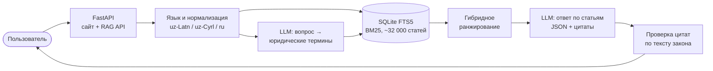

# Qonunchi — сайт законов Узбекистана с ИИ-помощником


**Для кого:** для людей, которые не знают законов и юридического языка, но хотят понять свои права. Человек спрашивает простыми словами на узбекском или русском, а ИИ-юрист отвечает **только по тексту действующих статей** из lex.uz и на каждое утверждение ставит ссылку с дословной цитатой.



📐 **Подробно:** [docs/ARCHITECTURE.md](docs/ARCHITECTURE.md) (диаграммы, модули, схема БД, ранжирование, защита от выдуманных ответов) и [docs/adr](docs/adr/) (почему выбраны именно такие решения).


Что есть на сайте:

- **Главная**: поиск, Конституция и все кодексы, новые законы.
- **Документы**: каталог с фильтрами (вид, действует или утратил силу, год).
- **Поиск** по тексту всех статей с подсветкой найденных слов.
- **Страница документа**: полный текст по статьям, содержание сбоку, поиск внутри документа, переключение узбекский/русский, ссылка на оригинал на lex.uz.
- **ИИ-помощник**: кнопка на каждой странице и отдельная страница. Отвечает только по найденным статьям, ставит ссылки [1], [2] на эти статьи и пишет предупреждение, что это не юридическая консультация.
- Два языка: узбекский (латиница) и русский.

## Как запустить у себя на компьютере

Нужен Python 3.10 или новее (https://www.python.org/downloads/, при установке на Windows поставьте галочку «Add Python to PATH»).

1. Скачайте папку `qonunchi` целиком (вместе с `data/laws.db`).
2. Windows: дважды щёлкните `start.bat`. Mac/Linux: в терминале `bash start.sh`.
3. Откройте в браузере http://localhost:8000

Без ключа помощник работает в **тестовом режиме**: показывает, какие статьи он нашёл, но сам ответ не пишет.

## Как подключить ChatGPT (ключ OpenAI)

1. Зайдите на https://platform.openai.com, пополните баланс (Billing) и создайте ключ (API keys).
2. В папке `qonunchi` скопируйте файл `.env.example` и назовите копию `.env`.
3. Откройте `.env` блокнотом и впишите ключ после `OPENAI_API_KEY=` (без пробелов и кавычек).
4. Перезапустите сайт. В помощнике пропадёт жёлтая надпись «Тестовый режим».

Ключ храните только в файле `.env`. Никому его не присылайте, в том числе в чат.

Сколько это стоит: на один вопрос уходит примерно 4–6 тысяч токенов (найденные статьи плюс ответ). На модели `gpt-4.1-mini` это доли цента за вопрос. Модель можно сменить строкой `OPENAI_MODEL=` в `.env`, если в вашем кабинете OpenAI есть более новая или более дешёвая.

Чтобы перейти на Claude: в `.env` поставьте `AI_PROVIDER=claude` и `ANTHROPIC_API_KEY=...`.

## Как обновить базу законов

Когда скачаются новые законы в `lexuz/data`, пересоберите базу:

```
python build_db.py ../lexuz/data data/laws.db
```

(или просто удалите `data/laws.db` и запустите `start.bat` / `start.sh`, база соберётся сама).

## Как выложить в интернет (потом)

Самый дешёвый вариант — маленький VPS за 4–6 $ в месяц (Hetzner, DigitalOcean, местные хостинги): там запускается `start.sh` или `Dockerfile`. Подойдут и Render / Railway (через Dockerfile). Ключ задаётся там в настройках как переменная `OPENAI_API_KEY`, а не в файле.

## RAG API для тестировщиков (/v1)

Сделано по ТЗ «RAG API — test spetsifikatsiyasi (lex.uz)».

- `POST /v1/rag/batch` — 1–10 вопросов (11 и больше → 400), `GET /v1/rag/batch/{batch_id}`, `POST /v1/rag/query`, `GET /v1/meta`, `GET /v1/health`.
- Доступ: заголовок `Authorization: Bearer <ключ>`. Ключи задаются в `.env` строкой `RAG_API_KEYS=`.
- Вопросы на узбекской латинице, кириллице и по-русски (язык определяется сам). Ответ на языке вопроса.
- В каждом ответе: `answer` со ссылками [n], `citations` (doc_id `lex:<номер>`, url, статья, часть, дата редакции, статус, дословная цитата, chunk_id), `contexts` top-k с `retrieval_score` и `rerank_score`, `no_answer`, `status`/`error`, `timing`, `usage`, `system`.
- Ищутся только действующие акты. Акты «о внесении изменений» понижаются в выдаче.
- Тот же `batch_id` с тем же содержимым → сохранённый ответ; с другим содержимым → 409. Дольше 110 с → 202, затем GET. Больше 5 запросов в секунду на ключ → 429 + Retry-After.
- `temperature=0` и `seed` передаются модели; переписанный ИИ поисковый запрос кэшируется, поэтому повторный вопрос даёт те же источники.

Проверка метрик (Hit@5, MRR, no-answer, выдуманные и устаревшие ссылки, латентность):

```
python eval/run_eval.py eval/sample_testset.csv --url http://localhost:8000 --key ВАШ_КЛЮЧ
```

Формат CSV как в ТЗ (раздел 6). `eval/sample_testset.csv` — пример на 10 вопросов, туда можно вписать все 100.

## Устройство (для программиста)

```
qonunchi/
├── app/                   online: веб-сайт и API (один процесс FastAPI)
│   ├── main.py            сайт: страницы, /api/chat, лимит запросов
│   ├── rag_api.py         RAG API /v1: батчи, ранжирование, проверка цитат
│   ├── db.py              единственный доступ к laws.db: каталог, BM25-поиск
│   ├── llm.py             OpenAI / Claude / тестовый режим, промпты
│   ├── textnorm.py        нормализация текста, стемминг, FTS-запрос
│   ├── translit.py        определение языка, кириллица → латиница
│   ├── chunking.py        нарезка длинных актов на пункты
│   ├── i18n.py            тексты интерфейса uz / ru
│   ├── templates/         Jinja2-шаблоны страниц
│   └── static/            CSS и JS (чат, навигация по документу)
├── build_db.py            offline: JSONL с lex.uz → SQLite + FTS5
├── rechunk_db.py          перенарезка готовой базы (с резервной копией)
├── merge_and_build.py     добавление новых актов в базу
├── eval/run_eval.py       метрики качества: Hit@5, MRR, no-answer, латентность
├── docs/                  архитектура и ADR
└── Dockerfile
```

- Архитектура, диаграммы и формула ранжирования: [docs/ARCHITECTURE.md](docs/ARCHITECTURE.md).
- Ограничение: `CHAT_LIMIT_PER_HOUR` вопросов в час с одного адреса.
